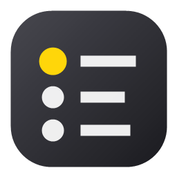

<p align="center">
  
</p>

<h1 align="center">Widget Notes</h1>

<p align="center">Notizen, To-dos und ein Spotify-Player als schicke Kacheln direkt auf dem Windows-Desktop – ähnlich wie die Widgets unter macOS.</p>

---

## Download

**[⬇ WidgetNotes.exe herunterladen](https://github.com/zSymon/widget-notes/releases/latest/download/WidgetNotes.exe)**

Einfach starten – keine Installation, kein .NET nötig. Läuft unter Windows 10 und 11 (64 Bit).

> Beim ersten Start kann Windows SmartScreen warnen („Der Computer wurde durch Windows geschützt“), weil die App nicht signiert ist. Dann auf **Weitere Informationen → Trotzdem ausführen** klicken.

## Funktionen

- **Echte Desktop-Kacheln** – liegen auf dem Desktop unter allen Fenstern, bleiben bei <kbd>Win</kbd>+<kbd>D</kbd> sichtbar, tauchen nicht in Taskleiste oder Alt+Tab auf
- **Raster mit Einrasten** – Kacheln beim Ziehen per Vorschau platzieren, sie weichen sich automatisch aus
- **Größe frei ziehen** – über den Griff unten rechts, rastet ins Raster ein; Schnellwahl Klein, Mittel, Groß, Hoch
- **Wächst mit** – läuft Text unten heraus, wird die Kachel automatisch größer
- **Bis an den Rand** – Kacheln lassen sich direkt an jeden Bildschirmrand setzen
- **Automatische Updates** – neue Versionen werden erkannt und per Klick installiert
- **Notiz oder Liste** – Aufgaben mit Haken, erledigte werden durchgestrichen
- **Spotify-Player** – Cover, Titel, Fortschritt, Steuerung und Lautstärke als Kachel, ohne Einrichtung ([mehr dazu](#spotify-player))
- **Termine** – Fälligkeitsdatum und Uhrzeit per Mini-Kalender, Markierung für heute und überfällig
- **Erinnerungen** – Windows-Benachrichtigung, wenn eine Aufgabe fällig ist
- **Anpassbar** – 8 Designs, eigene Verlaufs- und Akzentfarben, Transparenz, Eckenradius, Schriftart, Schriftgröße, Schatten und Glanz
- **Merkt sich alles** – jede Kachel bleibt auch nach einem Neustart auf ihrem Bildschirm und Platz; ist ein Bildschirm aus, wartet sie auf dem Hauptbildschirm und kehrt automatisch zurück
- **Autostart** – per Schalter im Menü der Kachel
- **Speichert automatisch** – alles landet in `%APPDATA%\WidgetNotes\notes.json`

## Bedienung

| Aktion | So geht's |
|---|---|
| Kachel verschieben | An einer freien Stelle (nicht im Text) ziehen |
| Größe ändern | Griff unten rechts in der Kachel ziehen |
| Neue Notiz | **+** in der Kachel oder <kbd>Strg</kbd>+<kbd>N</kbd> |
| Größe, Typ, Design, Löschen | **···** in der Kachel |
| Neue Aufgabe | <kbd>Enter</kbd> in einer Aufgabe oder in „Neue Aufgabe“ |
| Aufgabe löschen | <kbd>Rücktaste</kbd> in einer leeren Aufgabe |
| Termin setzen | Beim Überfahren einer Aufgabe auf das Kalender-Symbol klicken |
| Schriftgröße | <kbd>Strg</kbd> + Mausrad |
| Spotify-Player hinzufügen | Rechtsklick auf das Symbol im Infobereich → *Neuer Spotify-Player* (oder **···** → Typ *Spotify*) |
| Lautstärke im Player | Mausrad über der Kachel |
| Im Song springen | Auf den Fortschrittsbalken klicken |
| Desktop anzeigen | Linksklick auf das Symbol im Infobereich der Taskleiste |
| Mit Windows starten | **···** → Schalter „Mit Windows starten“ (oder Rechtsklick auf das Symbol im Infobereich) |
| Beenden | Rechtsklick auf das Symbol im Infobereich der Taskleiste |

> Tipp: Leg die `WidgetNotes.exe` vor dem Aktivieren des Autostarts an einen festen Ort (z. B. einen eigenen Ordner), denn der Autostart merkt sich den Speicherort.

## Spotify-Player

Die Spotify-Kachel steuert die **Spotify-App auf deinem PC** – ohne Anmeldung und ohne Einrichtung. Song, Cover und Play/Pause aktualisieren sich sofort, die Lautstärke kommt aus dem Windows-Lautstärkemixer. Sie rastet im selben Raster ein wie die Notizen und passt sich jeder Größe an (Klein, Mittel, Groß, Hoch oder frei gezogen).

Unter **···** gibt es:

- **Cover als Hintergrund** – weichgezeichnetes Cover, Farben passen sich dem Song an. Ausgeschaltet nimmt der Player das Design der Kachel an, also dieselben Farben wie deine Notizen.
- **Spotify-Konto (optional)** – damit funktionieren zusätzlich **Lieblingssongs (Herz)** und **Zufall**, und der Player zeigt auch Musik, die auf dem **Handy oder Lautsprecher** läuft.

### Spotify-Konto verbinden

Spotify verlangt dafür eine eigene **Client ID** (kostenlos, ca. 2 Minuten):

1. Im [Spotify Developer Dashboard](https://developer.spotify.com/dashboard) einloggen → **Create app**
2. Name und Beschreibung beliebig, Redirect URI: `http://127.0.0.1:8888/callback` eintragen und auf **Add** klicken
3. **Web API** anhaken, Bedingungen akzeptieren, speichern
4. Die **Client ID** kopieren, in der Kachel unter **··· → Spotify-Konto** einfügen → *Verbinden* und im Browser bestätigen

Alternativ trägt dich ein Freund in seiner App unter *User Management* ein (max. 5 Personen) und gibt dir seine Client ID. Für die Steuerung über das Konto braucht Spotify **Premium**.

Die Anmeldung wird verschlüsselt in `%APPDATA%\WidgetNotes\spotify.dat` gespeichert. Widget Notes steht in keiner Verbindung zu Spotify.

## Selbst bauen

Voraussetzung: [.NET SDK](https://dotnet.microsoft.com/download) (11 oder neuer)

```powershell
# Starten zum Entwickeln
dotnet run

# Einzelne, eigenständige WidgetNotes.exe nach .\dist bauen
.\publish.ps1
```
